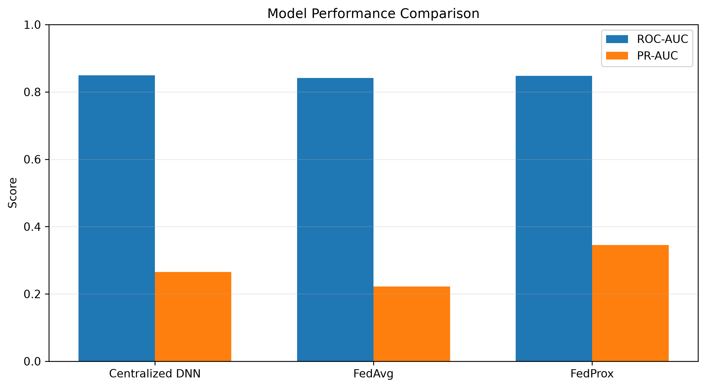
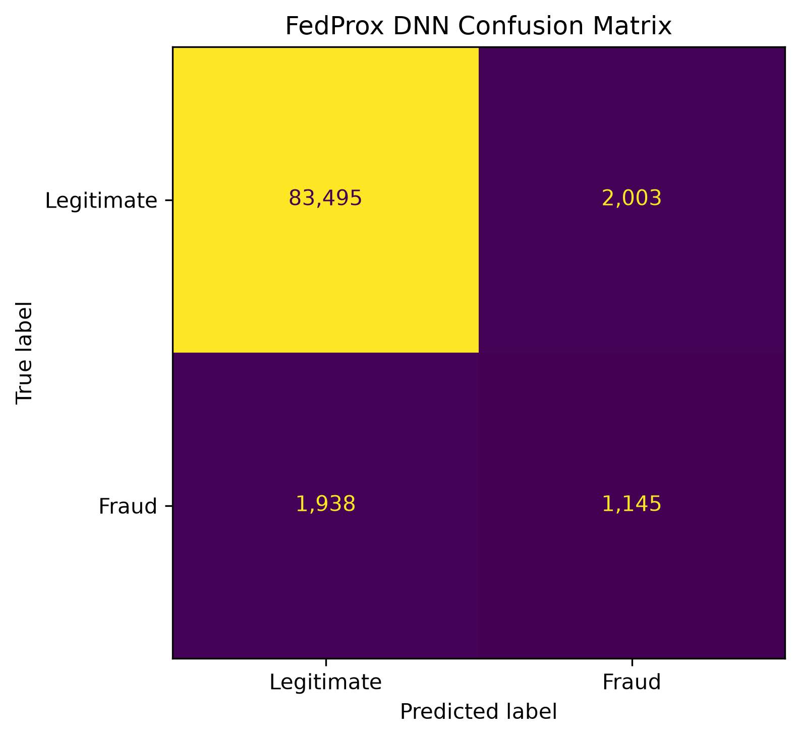
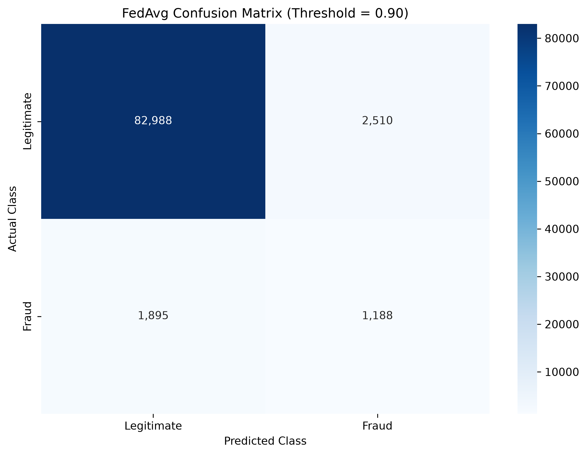
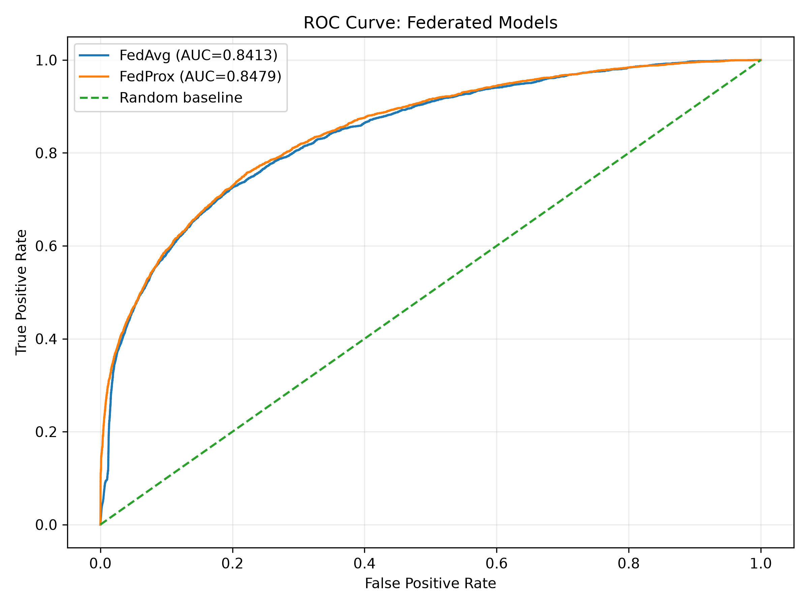
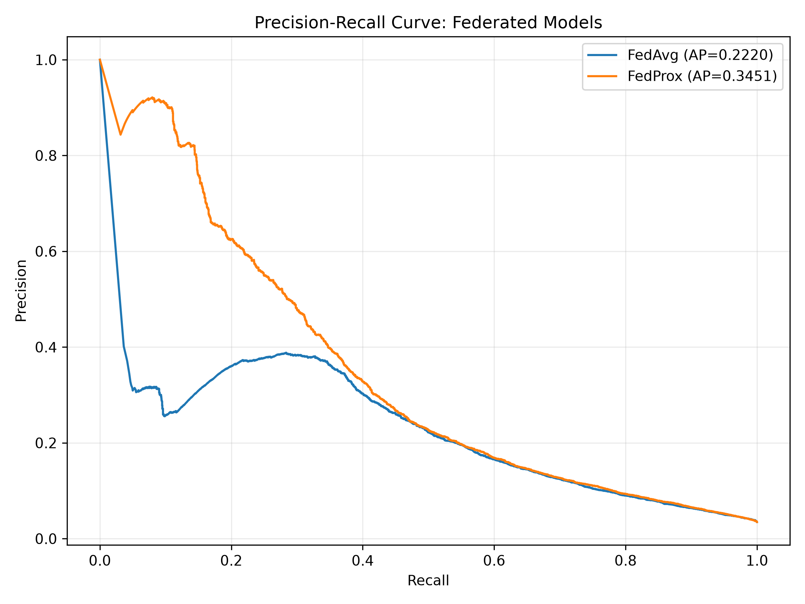
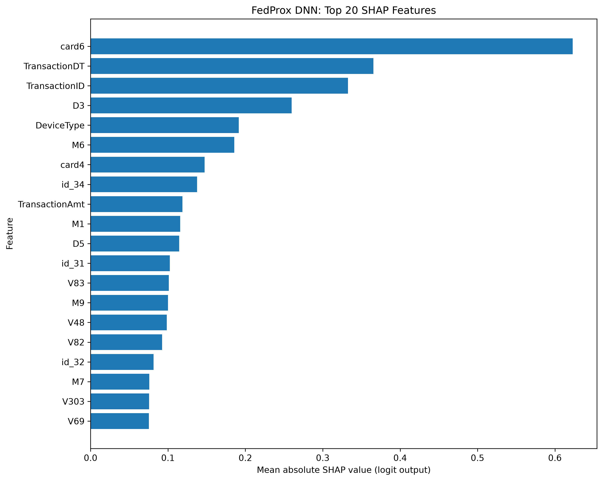

# Online Payment Fraud Detection — Final Research Results & Model Comparison Report

## Executive Summary
This report summarizes the empirical performance of **Federated Learning Strategies (FedAvg and FedProx)** evaluated on the held-out IEEE-CIS test dataset (**88,581 transactions**, including **3,083 fraudulent transactions**, ~3.48% positive class rate).

All decision thresholds were selected **exclusively on validation data** (`X_val_dnn.pkl`, `y_val_dnn.pkl`) prior to evaluating test set metrics to prevent data leakage and optimism bias.

---

## 1. Performance Comparison Matrix

| Model | Paradigm | Threshold | ROC-AUC | PR-AUC | Fraud Precision | Fraud Recall | Fraud F1 |
|---|---|---|---|---|---|---|---|
| FedProx DNN | Federated, Non-IID, μ = 0.01 | 0.85 | 0.8479 | 0.3451 | 0.3017 | 0.4171 | 0.3502 |
| FedAvg DNN | Federated, Non-IID | 0.90 | 0.8413 | 0.2220 | 0.3213 | 0.3853 | 0.3504 |

## Model Performance Comparison



---

## 2. Detailed Confusion Matrices (Held-out Test Set: 88,581 Transactions)

### **FedProx DNN (Federated, Threshold = 0.85)**
```
                    Predicted Legitimate    Predicted Fraud
True Legitimate:                  82,522              2,976
True Fraud:                        1,797              1,286
```
* **True Positives (Correctly Detected Fraud):** 1,286
* **False Positives (False Alarms):** 2,976
* **False Negatives (Missed Fraud):** 1,797
* **True Negatives (Correctly Identified Legitimate):** 82,522



---

### **FedAvg DNN (Federated, Threshold = 0.90)**
```
                    Predicted Legitimate    Predicted Fraud
True Legitimate:                  82,988              2,510
True Fraud:                        1,895              1,188
```
* **True Positives (Correctly Detected Fraud):** 1,188
* **False Positives (False Alarms):** 2,510
* **False Negatives (Missed Fraud):** 1,895
* **True Negatives (Correctly Identified Legitimate):** 82,988

## FedAvg Confusion Matrix

The following confusion matrix shows the FedAvg model's classification results on the held-out test set at the validation-selected threshold of 0.90.



---


## Results and Discussion

The FedProx model achieved a test ROC-AUC of 0.8479 and PR-AUC of 0.3451, while FedAvg achieved 0.8413 and 0.2220, respectively. FedProx therefore performed better on both ranking metrics. At the validation-selected operating thresholds, FedProx achieved a fraud recall of 0.4171 and F1-score of 0.3502, while FedAvg achieved a fraud recall of 0.3853 and F1-score of 0.3504. These results indicate that FedProx improved fraud detection recall and ranking performance relative to FedAvg, but did not improve the fraud F1-score. Both models missed a substantial number of fraudulent transactions, indicating scope for further improvement.

---

## 3. Methodology & Scientific Rigor

1. **Non-IID Partitioning:**
   - 5 simulated bank clients with non-identically distributed transaction volumes and device categories.
2. **Federated Proximal Optimization ($\mu = 0.01$):**
   - FedProx adds a proximal term $\frac{\mu}{2} \|w - w^t\|^2$ to local client loss functions, preventing local client model weights from drifting drastically away from the global server parameters under client heterogeneity.
3. **Strict Validation-Only Threshold Tuning:**
   - Evaluated candidate thresholds $T \in [0.05, 0.95]$ on validation predictions.
   - Validation F1 was maximized at $T = 0.85$ for FedProx (F1: $0.4239$) and $T = 0.90$ for FedAvg (F1: $0.4308$).
   - Applied the selected operating thresholds without modification to test evaluation.

---

## ROC Curve Comparison

The ROC curves compare the classification performance of the FedAvg and FedProx federated learning models across different decision thresholds.



## Precision-Recall Curve Comparison

The precision-recall curves evaluate the models' ability to identify fraudulent transactions in the imbalanced IEEE-CIS dataset.



---

## Explainable AI Using SHAP

SHAP (SHapley Additive exPlanations) was used to examine the contribution of input features to the FedProx DNN model's predictions. The initial analysis summarizes mean absolute SHAP values across three sampled test transactions.



The results provide an initial view of which features influence the model output for the sampled transactions. Further evaluation using a larger, representative sample is needed before drawing conclusions about global feature importance.

